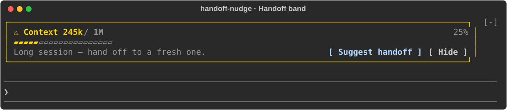
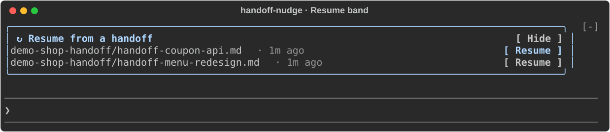

# handoff-nudge

Nudges you to `/handoff` before a long conversation runs out of room, and offers to resume from a recent handoff in a new one.

## Handoff band

Once the context passes the **Nudge threshold**, a band shows above the prompt.



- **Suggest handoff** asks the session's model what the next session should focus on and fills `/handoff <focus>` into the prompt.
- The band shows earlier when the threshold would sit past auto-compaction or the model's window: at 90% of whichever comes first, so it never misses its chance.
- If `/handoff` is not installed, the band offers **Install /handoff** instead. It fills the [skills.sh](https://skills.sh/) install command (`mattpocock/skills`) into the prompt for you to run: as a `!` shell line in the terminal, or as a request for Claude to run it in the desktop app, which has no `!` shell mode.

## Resume band

In a new or cleared conversation, a **Resume from a handoff** band lists up to three handoff docs `/handoff` wrote in this project during the last week. "This project" means its folder, a subfolder, or a folder above it other than your home folder or `/`.



- **Resume** fills the doc's path into the prompt so you can add what to do next.
- A doc stops being offered once you send a prompt containing its path or Claude reads it.
- Works on macOS, Linux, and Windows: it looks for docs in `$TMPDIR` or `/tmp`, and on Windows in `%TEMP%` or `%TMP%`, where your user folder (`%USERPROFILE%`) and drive roots such as `C:\` count like home and `/`.
- Terminal only: the desktop app starts Claude Code with the first message, so a new conversation there is never empty when the band could draw.

## Settings

| Setting | Default | Options |
| --- | --- | --- |
| **Nudge threshold** | 200k | 100k, 150k, 200k, 300k, 500k |

Change it in `/config`.

## Install

```
/plugin install handoff-nudge --marketplace thitiwats/claude-mods
```

## Develop

```sh
claude plugin validate plugins/handoff-nudge
claude plugin test plugins/handoff-nudge
```
