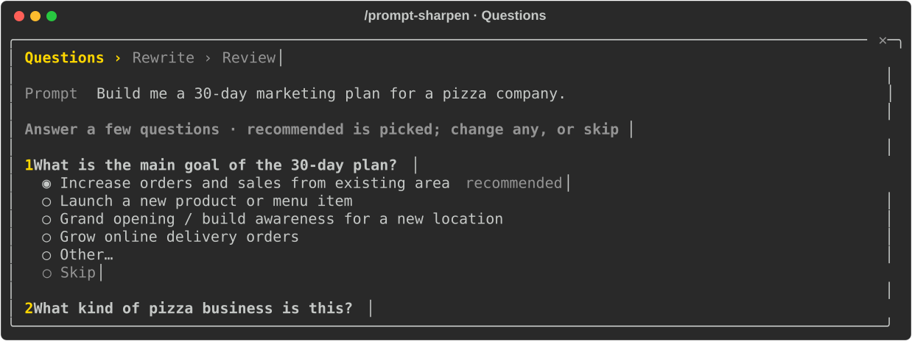
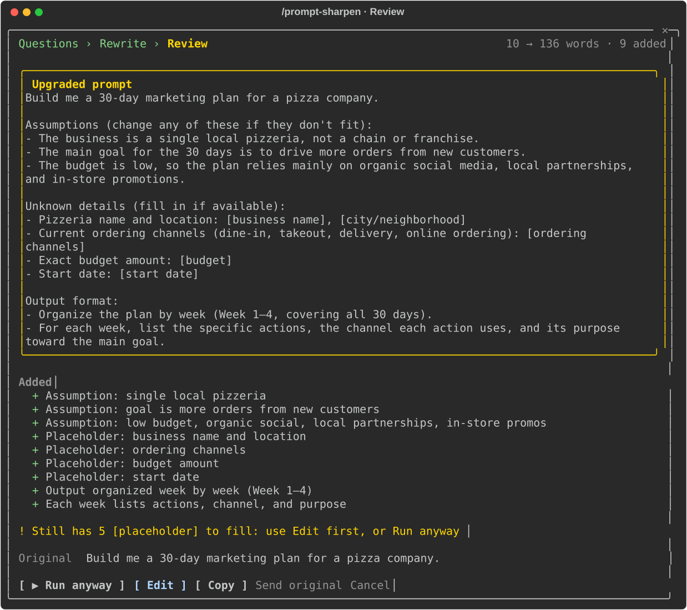

# prompt-sharpen

`/prompt-sharpen:upgrade <prompt>` opens a pane that walks your prompt through three steps: **Questions**, **Rewrite**, **Review**.

## Questions

Asks up to three multiple-choice questions about what the prompt leaves open. Each has its recommended answer already picked: change it, type your own with **Other**, or **Skip**.



## Rewrite

Rewrites the prompt clearer and more complete with the same intent, keeping every detail of the original. It adds only what came from your answers, the conversation, or structure and output format.

- An answer you left on its recommended option is written as an assumption.
- Anything still unknown stays a `[placeholder]`.

## Review

Shows the sharpened prompt first, then what was added, with your original as a single line below.



| Action | What it does |
| --- | --- |
| **Run it** | Sends it (with a warning and **Run anyway** while a `[placeholder]` is left) |
| **Edit** | Puts it in the prompt to change first |
| **Copy** | Copies it |
| **Send original** | Sends what you typed |
| **Cancel** / Esc | Puts your original back in the prompt |

## Notes

- It asks the session's own model over this conversation, or without it in a new or cleared one.
- Where the pane cannot open, your prompt goes back in the prompt untouched.

## Install

```
/plugin install prompt-sharpen --marketplace thitiwats/claude-mods
```

## Develop

```sh
claude plugin validate plugins/prompt-sharpen
claude plugin test plugins/prompt-sharpen
```

Grade the questions and rewrites with a real model and a judge model (about $1 a run on Opus; results go to `eval/results-<model>.json`):

```sh
bun plugins/prompt-sharpen/eval/run.ts [--model opus] [--judge opus] [--case <name>]
```
